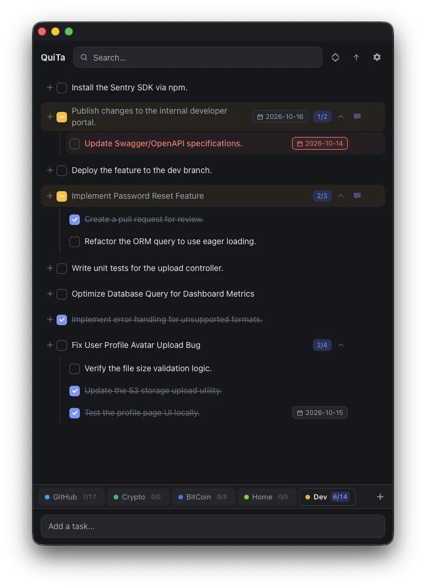
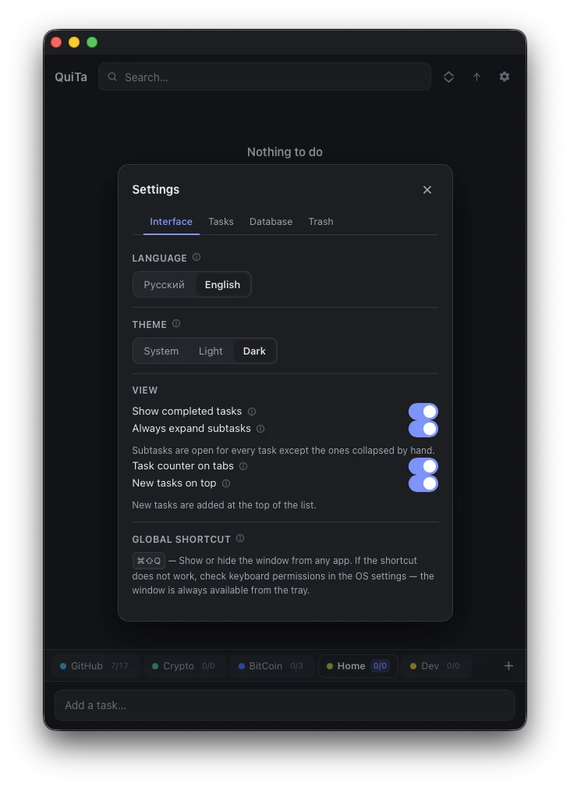
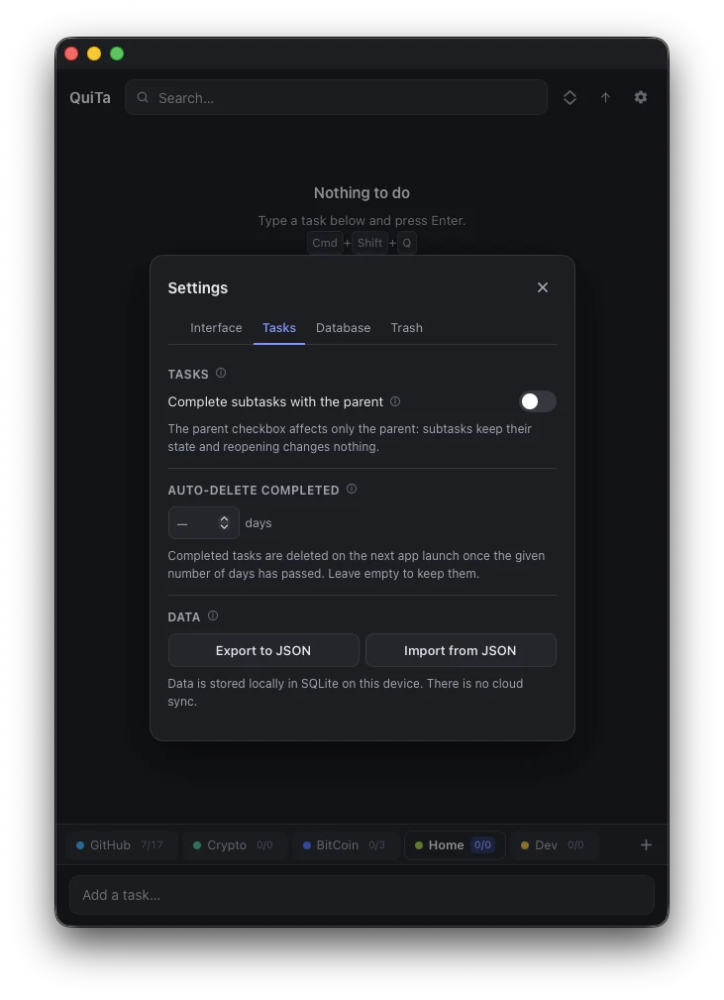
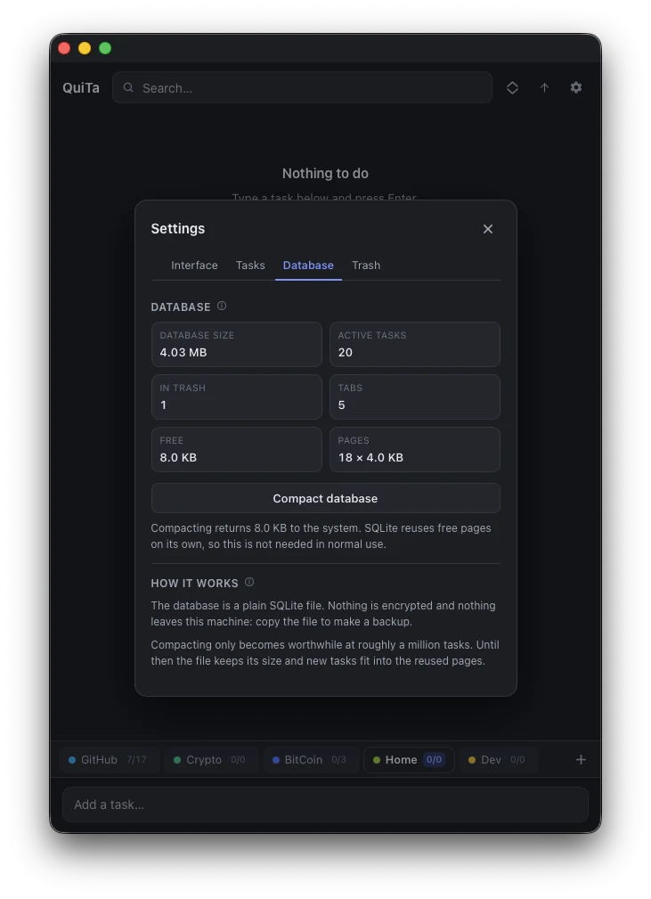
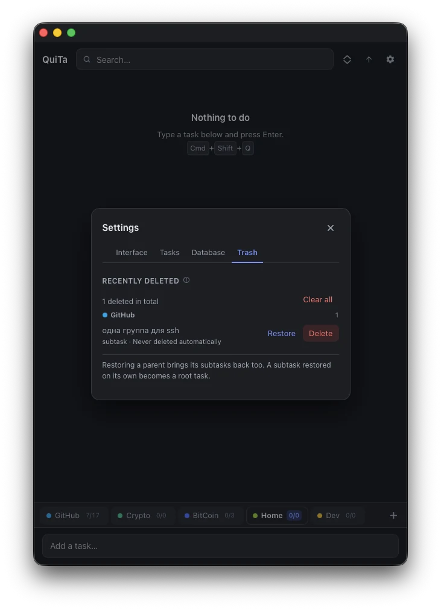
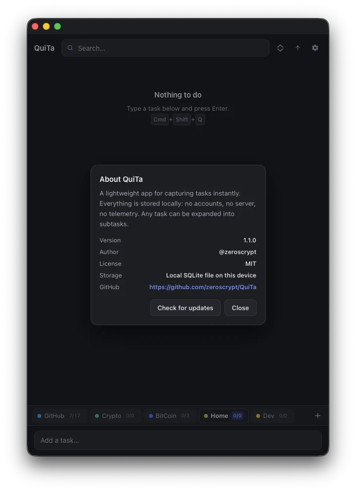

<div align="center">

# QuiTa

**Quick Tasks App**
A task manager that lives in the tray.

Captured a thought in a second — back to work.

[](https://github.com/zeroscrypt/QuiTa/actions/workflows/ci.yml)
[](https://github.com/zeroscrypt/QuiTa/releases/latest)
[](LICENSE)
[](https://tauri.app)
[](https://svelte.dev)
[](https://www.rust-lang.org)
[](https://sqlite.org)


English · **[Русский](README.ru.md)**

</div>

---

> [What this is](#what-this-is) · [Install](#install) · [Features](#features) · [How it works](#how-it-works) · [Data](#data) · [Development](#development) · [Project](#project)

---

## What this is

Every task manager offers **planning**. QuiTa offers **capture**.

A thought arrives while you are three hours into something else. Any serious
planner turns that into friction: find a window, find a list, pick a project,
think about a due date, write a description. The thought is gone and you end up
in a different app.

```
   ⌘⇧Q             window appears, caret already in the input
   "ping the supplier about the invoice"
   ⏎                saved, input cleared, caret stays put
   "send the invoice to the supplier"
   ⏎                saved again — as many times as you like
   +                on the first task, the subtask field behaves the same
   ────
   ~0.4 s per task — back in the editor
```

The task is saved and the caret stays where it was. The window does not hide on
its own — close it when you are done, not before. That is the whole product.
Everything else — tabs, subtasks, due dates, drag & drop — exists to make the
capture worthwhile *later*, never to slow down the moment you write it.

No accounts. No cloud. No telemetry. The database is one SQLite file on your
disk.

<p align="center">
  
</p>

### Who it is for

- [x] People who **lose thoughts between tools** — a thought is not a project, it is a note that must not dissolve.
- [x] People who **do not like** task managers and do not want to run a system.
- [x] People who need a **private file**, not a service that can shut down or turn paid.

---

## Install

- [x] **Ready build, one command** — macOS and Linux
- [x] **Ready build, one command** — Windows
- [x] **Download the file** — `.dmg`, `.msi`, `.AppImage`, `.deb`
- [x] **Build from source**
- [x] **Integrity check** — SHA-256 for every artifact in `SHA256SUMS`

### macOS and Linux — one command

```bash
curl -fsSL https://raw.githubusercontent.com/zeroscrypt/QuiTa/main/scripts/install.sh | bash
```

The script detects your OS and CPU, downloads the right file, verifies its
SHA-256 against the published checksum, and only then unpacks it. Nothing runs
before the check passes.

### Windows — one command

```powershell
irm https://raw.githubusercontent.com/zeroscrypt/QuiTa/main/scripts/install.ps1 | iex
```

Run it from PowerShell **as administrator** — the installer is machine-wide,
and without the rights Windows refuses it silently, with exit code `1603`.
The script checks for that up front and says so when the rights are missing.

### Download manually

[**Releases**](https://github.com/zeroscrypt/QuiTa/releases/latest) → pick the
file for your system:

| Platform | File |
|----------|------|
| macOS (Apple Silicon, Intel) | `QuiTa_<version>_aarch64.dmg` · `QuiTa_<version>_x64.dmg` |
| Windows | `QuiTa_<version>_x64-setup.exe` · `QuiTa_<version>_x64_en-US.msi` |
| Linux | `QuiTa_<version>_amd64.AppImage` · `QuiTa_<version>_amd64.deb` |

### From source

**Required:** Node.js 22+, pnpm 12+, Rust stable. On Linux also
`libwebkit2gtk-4.1-dev`, `libappindicator3-dev`, `librsvg2-dev`, `patchelf`.

```bash
git clone https://github.com/zeroscrypt/QuiTa.git
cd QuiTa
pnpm install
pnpm tauri dev          # run with hot reload
pnpm tauri build        # produce installers
```

`pnpm tauri build` produces `.app` + `.dmg` on macOS, `.msi` + `.exe` on
Windows, `.AppImage` + `.deb` on Linux.

> You do not need a signing key to build locally: the update artifacts are
> produced only in CI, where the key lives as a GitHub secret.

---

## Features

- [x] **Tabs as projects** — create, rename by double click, reorder by drag, automatic colour from a 10-colour palette. Deleting a tab asks first and one click undoes it: the tab goes first, and its tasks wait out ten seconds before following it into the trash.
- [x] **Subtasks** — exactly one level deep, and that is the limit.
- [x] **Not relevant** — retire a task without deleting it: a red, dimmed row with a cross, closed status in every list. A menu item plus `Cmd+D`/`Ctrl+D` on the last-pressed task.
- [x] **Due dates** — calendar dates with no timezone shift, overdue tasks highlighted, chips for today / tomorrow.
- [x] **Comments** — autosaved, opened from the button next to a task.
- [x] **Storm entry** — the field never closes after `Enter`, the caret stays put.
- [x] **Drag & drop** — three zones, no timers and no dwell.
- [x] **Recycle bin** — soft cascade delete, a 200-task bound and automatic retention cleanup.
- [x] **Search** — no delay, keeps the parent context.
- [x] **Dark and light theme** — follows the system or pinned manually.
- [x] **Русский and English** — switched in settings, applied immediately.
- [x] **Lives in the tray** — closing the window hides the app instead of quitting.
- [x] **Hotkey** — `⌘⇧Q` on macOS, `Win+Alt+Q` on Windows, `Ctrl+Alt+Q` on Linux — opens the window with the caret in the input.
- [x] **Export and import** — a snapshot of the whole app as JSON.
- [x] **In-app updates** — a green strip above the tabs: "Version 1.1.4 is available".
- [x] **Resizable window** — double-click the logo to fill the height of the screen's work area and widen by 1.6×. The taskbar and the menu bar never cover the window, and it always stays fully on screen.
- [x] **Overdue highlighting** — a separate colour, not just a date.
- [x] **Keyboard first** — `Enter` saves, `Esc` cancels, the caret never jumps.

### Settings

<p align="center">
  
  
  
  
</p>
<p align="center">
  
</p>

### What QuiTa will never do

- [ ] ~~Sync between devices~~ — not available. Honest export instead.
- [ ] ~~Collaboration~~ — not available.
- [ ] ~~Telemetry, analytics, crash reports~~ — not available.

Each of these is a reason to stop being a buffer.

---

## How it works

### Storm

```
   ┌──────────────────────────────────────────┐
   │ Write the release notes                  │  ⏎
   │ Send the invoice to the supplier         │  ⏎
   │ Collect the parcel                       │  ⏎
   └──────────────────────────────────────────┘
```

`Enter` creates the task, clears the field and keeps the caret. Press `+` on a
root task and the subtask field behaves identically.

### Switching tabs

`Cmd+1`…`Cmd+9` on macOS, `Ctrl+1`…`Ctrl+9` on Windows and Linux — the same
binding every app with tabs already uses. The digit is the position in the
tab strip, so dragging tabs around renumbers them.

The caret lands in the task input either way, so a task can be typed into the
tab just selected. A digit past the last tab does nothing, and an open dialog
takes the shortcut for itself.

Clicking a tab with the mouse behaves the same way: the input is ready
immediately.

### The other shortcuts

| Shortcut | What it does |
|----------|--------------|
| `Cmd+T` / `Ctrl+T` | a new tab — opens the same name field as the "+" button |
| `Cmd+F` / `Ctrl+F` | caret into the search field |
| `Cmd+S` / `Ctrl+S` | settings |
| `Cmd+D` / `Ctrl+D` | mark the last-pressed task "not relevant": red, dimmed, a cross in the checkbox; counts as closed |
| `Cmd+1`…`Cmd+9` / `Ctrl+1`…`Ctrl+9` | switching tabs (above) |

All three take the same modifier as the digits, and hand the keyboard to an
open dialog exactly as those do. The full list lives in the settings, under
"Global shortcut", written for the keyboard in front of you. `Cmd+T` does not create a nameless tab behind
your back: it opens the same field the button opens, name included — the name is
what the tab is for.

### Escape

`Esc` closes the topmost layer, one layer per press: date, comment, menu,
delete confirmation, settings. Each of them used to listen for the key
independently, so a single press shut all of them at once, and the delete
confirmation did not respond to it at all.

Once the last layer is gone the caret lands in the task input. With nothing
open, `Esc` clears the field, as it always did.

### Three drag zones

```
   ┌─────────────────────────────────────────┐
   │ ░░░░░░░░ insert above ░░░░░░░░░░░░░░░░░ │  top quarter
   │ ▓▓▓▓▓ release → becomes a subtask ▓▓▓▓▓ │  middle half
   │ ░░░░░░░░ insert below ░░░░░░░░░░░░░░░░░ │  bottom quarter
   └─────────────────────────────────────────┘
```

- [x] **No holding, no timers.** The insertion point is visible *before* you let go.
- [x] **The last position is real.** Empty space under the list means "insert at the end".
- [x] **Tasks and tabs both drag.** A task onto a tab moves it with its subtasks.
- [x] **Cycles are impossible** — a task cannot nest inside its own subtree.

### Completion rules

- [x] **Completing a parent either cascades to its subtasks or leaves them alone** — your choice in settings.
- [x] **Reopening restores exactly the subtasks the cascade completed**, never the ones you finished yourself.
- [x] **A subtask never touches its parent.** Unchecking one leaves the task closed and ◐ partially done.

### The recycle bin

- [x] **A task goes to the bin together with its subtasks.** A parent cannot stay behind without them: they would hang in lists where nothing shows them.
- [x] **The bin keeps 200 tasks** — the number is yours to set, and zero turns the rule off. When it is full, the next task pushes the oldest out for good, subtasks included, and the rest shift up. The bound holds on every path into the bin — a task you delete, the completion timer, a whole tab — and each of them says what it pushed out.
- [x] **How long it keeps them is a separate setting** — off by default, because nothing may be deleted on its own. Turn it on and a tree that has sat there that many days leaves on the next launch. The countdown starts at the last deletion in the tree, so a subtask thrown out after its parent gets its full term.
- [x] **Displacement is announced.** That task did not go by your choice, so the toast names the one that left.
- [x] **The header shows the real number**, not what fits on screen; the rest comes with "Show more".


---

## Data

- [x] **One SQLite file on the device.**
- [x] **No network connection at all** — except the update check.
- [x] **Export is a snapshot of everything**: tasks with their hierarchy, the recycle bin, tabs, settings.
- [x] **Import never deletes** — it only adds and updates records by `id`.
- [x] **Broken hierarchy is repaired**: a subtask without a parent becomes a root task instead of vanishing.

```json
{
  "version": 2,
  "exportedAt": "2026-10-14T09:41:00Z",
  "tabs": [{ "id": "…", "name": "Work", "color": "#4c6fff", "sortOrder": 0 }],
  "settings": { "theme": "dark", "language": "en", "newestFirst": true },
  "tasks": [{ "id": "…", "title": "Ping the supplier", "parentId": null, "tabId": "…" }]
}
```

One format — JSON: every tool reads it and it contains no parser a hostile file
could break. Version 1 files import as-is.

| Platform | Database path |
|----------|---------------|
| macOS | `~/Library/Application Support/com.quita.app/quita.db` |
| Windows | `%APPDATA%\com.quita.app\quita.db` |
| Linux | `~/.local/share/com.quita.app/quita.db` |

> `Application Support` is not synced by iCloud Drive. If you want one database
> across two Apple devices, move the file yourself or use the export: iCloud
> syncs whole files, so two running apps would overwrite each other.

---

## Development

### Stack

| Layer | Choice | Why |
|-------|--------|-----|
| Shell | **Tauri 2** | Megabytes instead of hundreds; native window, tray and hotkeys. |
| UI | **Svelte 5** (runes) | Fine-grained reactivity — the app is almost entirely lists. |
| Language | **TypeScript** | Strict types and a shared contract with Rust. |
| Logic | **Rust** | Completion rules, cascades, migrations — pure functions under test. |
| Storage | **SQLite** (`rusqlite`, bundled) | One file, no server, no native dependencies. |

```
frontend (Svelte 5 + TS)  ──invoke──▶  Tauri commands  ──▶  repository (rusqlite)
        │                                                          │
        └────────────────────  events  ◀────────────────────────────┘
```

Business rules live in `src-tauri/src/domain/rules.rs` as a pure function
returning a plan, and the repository only applies it. Everything interesting is
therefore testable without a window.

### Commands

| Command | What it does |
|---------|--------------|
| `pnpm tauri dev` | Run with hot reload |
| `pnpm tauri build` | Installers for the current platform |
| `pnpm check` | Svelte and TypeScript types |
| `pnpm test` | 176 unit tests |
| `cargo test --manifest-path src-tauri/Cargo.toml` | 166 Rust tests (47 unit + 115 integration against a real database + 4 guarding the docs) |
| `cargo clippy --manifest-path src-tauri/Cargo.toml --all-targets` | Lints, errors as warnings |
| `cargo audit` | Vulnerabilities in dependencies |

### What it costs

| | |
|---|---|
| App size | 17.9 MB — almost entirely the binary |
| `.dmg` size | 5.8 MB — the same thing compressed |
| Database | 618 bytes per task |
| Query time | 1.5 ms to search, 11 ms to list a thousand |

These numbers were measured, not estimated: a database of 1000 tasks takes
604 KB once compacted. The timings come from that same database — listing a
thousand tasks takes 11 ms, so on a real database of a few dozen tasks
everything is orders of magnitude faster.

The size of the database file follows its history rather than the number of
tasks in it: SQLite does not hand space back until it is compacted. The
"Compact database" button in settings does that by hand.

---

## Project

### Documentation

| | |
|---|---|
| [`docs/PRODUCT.md`](docs/PRODUCT.md) | Product description, positioning, boundaries |
| [`docs/UX_SPEC.md`](docs/UX_SPEC.md) | Layout, gestures, keyboard |
| [`docs/TASK_RULES.md`](docs/TASK_RULES.md) | Completion, cascade, reparenting, cycles |
| [`docs/ARCHITECTURE.md`](docs/ARCHITECTURE.md) | Process boundaries, IPC, stores |
| [`docs/DATA_MODEL.md`](docs/DATA_MODEL.md) | Tables, columns, migrations, export format |
| [`docs/TEST_PLAN.md`](docs/TEST_PLAN.md) | Automated tests and a manual checklist |
| [`docs/DISTRIBUTION.md`](docs/DISTRIBUTION.md) | Release, signing, notarization |
| [`docs/ROADMAP.md`](docs/ROADMAP.md) | What is planned next |

### Contributing

Issues and pull requests are welcome — read
[`CONTRIBUTING.md`](CONTRIBUTING.md) first. Report security problems to
[`SECURITY.md`](SECURITY.md), not to public issues.

### License

[MIT](LICENSE) © [zeroscrypt](https://github.com/zeroscrypt)